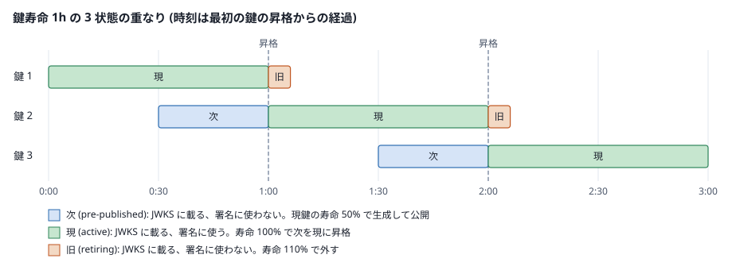
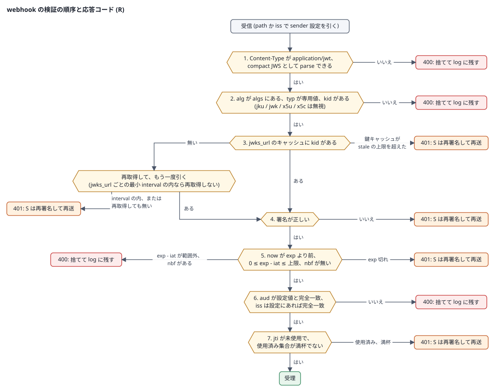
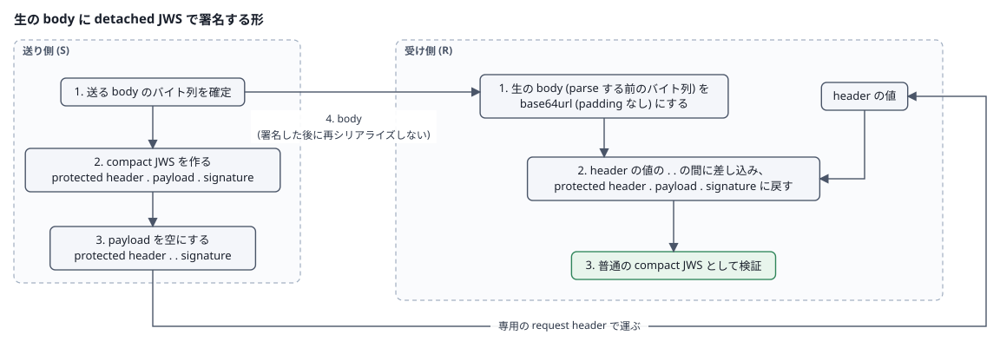
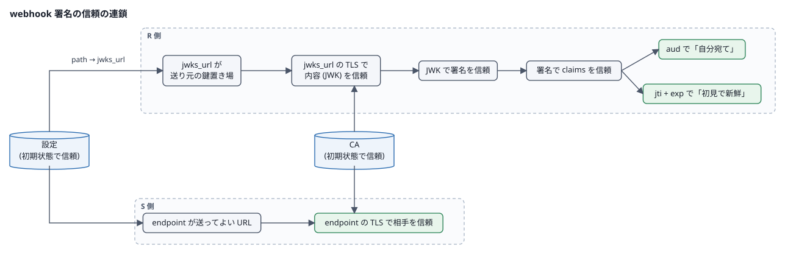

# JWKS を信頼の根にした webhook 署名 (鍵管理ゼロのメッセージ単位認証)

公開 endpoint を持つサービス同士で、送り側 (S) が受け側 (R) の endpoint へイベントを POST する webhook を、**IP 許可リストも共有 secret も配布鍵も持たずに**認証する設計。信頼の根は Web PKI で、S の identity は「R の設定に書かれた `jwks_url`」に置く。`peer-auth-url-identity` の P1 (ステートフル接続) を満たさない場面の方式で、鍵キャッシュ・リプレイウィンドウ・鍵の世代管理を代わりに持つ。

## 一般的な方式との位置づけ

| 方式 | 代表例 | 管理対象 | 本文書が採らない理由 |
|---|---|---|---|
| HMAC 共有 secret (timestamp + 署名ヘッダ) | GitHub / Stripe / Shopify、Standard Webhooks `whsec_` | endpoint ごとの secret の生成・配布・保管・rotate | 受け手ごとに secret を配って更新する手間が要る。検証できる受け手は同じ secret で署名も作れるので、署名が「送り手が作った」ことの証明にならず、受け手の側から漏れても偽造される |
| 非対称署名 + 公開鍵の配布 | Standard Webhooks `whpk_`、Apple (x5c) | 送り側公開鍵の配布と rotate 時の再配布 | 鍵を替えるたびに受け手へ配り直す。Standard Webhooks の公開鍵方式は、公式ライブラリの対応が言語で揃っていない (JavaScript と Python は対応、Go・Rust・Ruby は未対応) |
| 署名を URL の query に載せる | 署名付き URL の類 | 方式による | URL はアクセスログ・プロキシのログ・履歴に残り、署名がそこに残る |
| **JWS + JWKS (本文書)** | Google Cloud Pub/Sub push (OIDC token を `Authorization` header に載せ、body は署名されない。本文書は body を署名で覆う点が違う) | `jwks_url` 1 つ。rotate は自動 | — |
| RFC 9421 HTTP Message Signatures + JWKS | Cloudflare Web Bot Auth | 同上 | method / path / header も署名対象にできるが、body を覆うには `Content-Digest` (RFC 9530) を足して署名対象に入れる必要があり、受け手は digest の照合と署名対象の組み立ての両方を実装する。ライブラリも薄い |
| mTLS | 社内間 | CA と証明書配布 | 証明書の配布と更新が要る |

JWS + JWKS は「鍵管理ゼロ」を満たす中で最も標準に近く、JOSE ライブラリだけで実装できる。代償は信頼の根が TLS / DNS に移ること (R が `jwks_url` を信頼する = その origin の TLS を信頼する)。**webhook 署名の方式 選定判断基準日: 2026-11-27** (選定を変えたらこの日付と根拠も一緒に更新する)

## body の運び方を選ぶ

署名の付け方は 2 通りあり、鍵・JWKS・検証の規則は共通。違うのは body の形と、束縛する値 (`aud` / `iat` / `exp` / `jti`) の置き場。

| | body を JWT にする | 生の body に detached JWS で署名する |
|---|---|---|
| body | `application/jwt` の compact JWS (アプリの payload は claims の中) | アプリの JSON のまま |
| 署名の置き場 | body そのもの | request header (payload を抜いた compact JWS) |
| 束縛する値の置き場 | claims | protected header |
| 検証しない受け手 | body を JWT として decode しないと中身を取れない | header を無視すれば、そのまま読める |
| 入れ方 | 送り手と受け手が同時に切り替える | 「署名なし → 署名あり・検証は任意 → 検証必須」と段階的に入れられる |

選ぶ軸は「検証しない受け手を許すか」の 1 つ。

- **許さない** (受け手が全部最初から検証する。新しく作る口): body を JWT にする。以下の「token」「検証」の節がこの形
- **許す** (既にある受け手を壊さずに署名を足す。検証は受け手の準備ができてから必須にする): 生の body に detached JWS で署名する。「生の body に署名する形」の節

どちらの形でも、検証を省いた受け手は書ける (JWT は decode するだけで中身が読める)。detached の形は、省いた受け手が何も変えずに動き続けるので、検証しないまま残りやすい。「検証は任意」の間は守りが無く (署名を外した偽の request が通る)、守りになるのは受け手が検証を必須にしてから。

## 前提

| # | 条件 | 満たさない場合 |
|---|---|---|
| P1 | S が公開 FQDN と有効な TLS 証明書を持ち、`jwks_url` を https で配信する | 信頼の根が無い |
| P2 | R の endpoint が https | S が R を認証できない (送信先の確認は TLS に依存) |
| P3 | S と R の時刻が同期している。S の時計の遅れと転送にかかる時間の合計が、その用途の token 寿命 (webhook は 30 秒、読み出しは 5〜10 秒) より十分小さい | S の時計が遅れていると `exp` 切れで落ちる (R は `now` に猶予を足さない)。S の時計が進んでいても落ちないが、進んでいる分だけ token が長く通る (検証の節の 5)。許容幅を広げず、ズレた相手を可用性の問題として扱う |
| P4 | S のインスタンスが 1 つ、または JWKS を全インスタンスの鍵を集約した形で配信できる | プロセスごとのエフェメラル鍵が `jwks_url` に載らず、R が常に未知 kid を見る |

P4 の集約は同じ S のインスタンス間の話で、**別の S が同じ `jwks_url` を共有する**構成 (複数サービスの鍵を 1 つの JWKS に載せる) は追加の条件を要する。`iss` が任意のままだと S_a が S_b の `iss` を名乗って自分の鍵で署名でき、R は同じ JWKS から S_a の鍵を引いて検証に成功してしまう。この構成では R は `iss` を必須にし、JWK 側にも `iss` (または `kid` の接頭辞) を持たせて **鍵空間を `iss` ごとに分離する** (`peer-auth-url-identity` の「鍵空間は `iss` ごとに分離する」と同じ条件)。R は claims の `iss` に対応する鍵だけから `kid` を引く。

## 設定

R (受け側) は送り元 (sender) 単位で持つ。受け口が 1 つなら `path` は省略できる。複数の sender を持つなら、受信 path か `iss` のどちらかで `jwks_url` が一意に引けなければならない (受け口の種類が多いなら path で分ける方が無駄が無い)。同じ `jwks_url` を複数の sender が共有するなら `iss` は必須 (前提の節)。

```
senders:
  - path: /hooks/s2            # 受け口が 1 つなら省略可
    jwks_url: https://s2.example/.well-known/jwks.json
    aud: https://s1.example/hooks/s2   # S が発行した値を転記。省略時は受け口の URL
    iss: s2                            # 任意 (jwks_url を共有する構成では必須)。指定時は完全一致
    key_lifetime: 1h                   # S の鍵寿命。省略時は標準の 1h
algs: ["ES256"]                        # 許可リスト。今は 1 本だが複数前提の形
```

`key_lifetime` は S が決める値を R に写したもの。R は、定期再取得の interval と、再取得が失敗し続けた時にキャッシュを信じる上限を、この値から決める (鍵キャッシュの節)。S が鍵寿命を標準から変える時は、R のこの値も合わせる。

S (送り側) は送信先単位で持つ。`aud` は **S が発行**し、R に転記してもらう (登録レコードを持つのは S なので)。既定値は endpoint URL で、S が知っている URL と R が自分と思っている URL は一致するので、既定のままならやり取りは要らない (R が自分の受け口 URL を確定する手順は [self-endpoint-identification](self-endpoint-identification.md))。`aud` の役目は「受け口ごとに一意で R が完全一致で検証する」ことだけなので、誰が決めても安全性は変わらない。

```
webhooks:
  - endpoint: https://s1.example/hooks/s2
    aud: https://s1.example/hooks/s2   # 省略時は endpoint
```

## 鍵の世代管理 (S)

S は起動時にエフェメラルな P-256 の鍵ペア (ES256 用。alg の選び方は「token」の節) を作り、ランダムな `kid` を採番する。鍵は 3 状態を持ち、1 つの鍵の束で JWKS に同時に載るのは最大 2 本 (「旧」は現鍵の寿命 10% で外れ、「次」は 50% で載るので、3 つが重なる時は無い)。決める固定値は**鍵寿命 1 つ (標準 1h)** だけで、遷移はすべてその比率で書く。**寿命の起点は昇格 (active になった時刻)** で、50% で作られた「次」は作られてから昇格までの間は寿命を消費しない (起動時に作る最初の鍵は作った時刻が昇格時刻)。

| 状態 | JWKS に載る | 署名に使う | 遷移 |
|---|---|---|---|
| 次 (pre-published) | 載る | 使わない | 現鍵の寿命 **50%** で生成して公開 |
| 現 (active) | 載る | 使う | 寿命 **100%** で「次」を「現」に昇格 |
| 旧 (retiring) | 載る | 使わない | 寿命 **110%** で外す |

鍵寿命 1h のときの重なりを時間軸に置くと次の通り (時刻は最初の鍵の昇格からの経過)。どの時点でも JWKS に載るのは 2 本までで、旧と次は重ならない。



成立条件は 2 本ある。

- (a) retiring 窓: `10% × 鍵寿命 > token 寿命 + 未知 kid 時の再取得の最小 interval` (1h なら 6 分 > 30 秒 + 30 秒)。昇格直前に旧鍵で署名した token が、R のキャッシュ miss と最小 interval を挟んでも旧鍵が JWKS に残っているうちに検証できる条件
- (b) 事前公開が効く条件: `50% × 鍵寿命 > R の定期再取得 interval + jwks_url の応答のキャッシュ時間` (1h なら 30 分 > 10 分 + キャッシュ時間)。「次」が昇格する前に、R の定期取得が「次」の載った JWKS を必ず 1 回は拾う条件。キャッシュ時間は、`jwks_url` の応答に付ける `Cache-Control: max-age` と、CDN を挟むならその TTL

鍵寿命を極端に短くするとこれらが破れるので、短くする時は (a) (b) の両方を確認する。**次鍵の事前公開が肝**: 期限直前 (99% など) に初めて公開すると、R のキャッシュは必ず miss し、再取得の最小 interval や一時的な fetch 失敗と重なった間のイベントが全部拒否される。50% 公開なら R の定期取得 (下記) が先に拾う。`jwks_url` の応答のキャッシュ時間は (a) の retiring 窓より短くする (1h なら 6 分未満)。長いと 2 つのことが起きる。R の再取得が「次」の載っていない古い JWKS を掴んで (b) が破れる。S が外した鍵が古い JWKS に残って見え、その時間だけ失効が遅れる。

鍵の置き場は 2 通りで、**プロセス外 (ファイル等) に置けるなら置く**。置けば再起動を跨いで同じ束を出せるので、R の未知 kid 再取得が起きず、複数インスタンスや rolling restart でも「誰が答えても同じ JWKS」(P4) が成り立つ。秘密鍵がディスクに 1 つ増える代償は、寿命 1h の鍵なので限定的。複数インスタンスが鍵ファイルを共有する構成では、「次」を作る役を 1 つに決める (ファイルの lock を取った者が作り、他はその結果を読む)。各自が作ると束が割れて P4 が破れる。メモリだけに置く構成 (置き場が無い、単一インスタンス) では再起動で鍵は全部作り直しになり、送信中だった旧鍵の token は R 側のキャッシュが残っていれば通り、残っていなければ R が拒否して S の再送に任せる。

## token (S → R)

body を JWT にする形。body は `application/jwt` の compact JWS で、payload 全体が署名で覆われる。

```
header:  { "alg": "ES256", "kid": "<kid>", "typ": "webhook+jwt" }
claims:  {
  "iss": "s2",                            # S を名指す固定の識別子 (URI でなくてよい)。R の設定に iss があれば完全一致
  "aud": "https://s1.example/hooks/s2",   # S が発行した値、既定は endpoint URL
  "iat": 1760000000,
  "exp": 1760000030,                      # iat + 30 秒
  "jti": "<ランダム、送信試行ごとに一意>",
  "event": { ... }                        # アプリの payload
}
```

- `iss` は S を名指す固定の識別子で、URI である必要は無い (`llm-gateway` のような名前でよい)。R は設定にあれば完全一致で見る。S が自分の外向き URL を知らない構成では名前の方が自然
- `exp` は **`iat` + 30 秒** (標準値)。Standard Webhooks の 5 分は retry queue の遅延込みの値で、**S が送信試行ごとに署名し直す**なら 30 秒で足りる。生成時に 1 回だけ署名して queue に積む実装では、1 回目の失敗後の再送が全部 `exp` 切れになるので、再署名が 30 秒の前提
- `alg` の既定は `"ES256"` (RFC 7518 §3.4。JOSE の ES256 は P-256 と SHA-256 まで決まる)。**alg 選定判断基準日: 2026-11-27** (選定を変えたらこの日付と根拠も一緒に更新する)
  - 第一の理由: Apple の環境で使える「取り出せない鍵」が、楕円曲線では P-256 だけ。Secure Enclave の楕円曲線の鍵は P-256 に限られ (Apple の文書 "Protecting keys with the Secure Enclave": "Works only with NIST P-256 elliptic curve keys")、Ed25519 の鍵は作れない。Apple のプラットフォームの認証器 (iCloud キーチェーンの passkey) が作る credential も ES256 (COSE の -7) だけ (WebKit の `LocalAuthenticator` は `pubKeyCredParams` に -7 が無ければ `NotSupportedError` を返す。AuthenticationServices の `ASCOSEAlgorithmIdentifier` に定義された値も `ES256` だけ。外付けのセキュリティキーは別の話)。なので、送り手の署名鍵をハードウェアに閉じ込める構成と、passkey の検証と鍵の扱いを 1 つにまとめる構成では、ES256 しか選べない
  - 第二の理由: ライブラリと受け手の対応が最も広い (IANA の JOSE の登録簿で `Recommended+`)
  - `"Ed25519"` (RFC 9864 の fully-specified な識別子) を選んでよいのは、ハードウェアの鍵を使わず、S と R の両方のライブラリが `"Ed25519"` という識別子に対応している構成。識別子の対応はまだ揃っていない (JavaScript の `jose` は対応。PyJWT、golang-jwt、Rust の jsonwebtoken が載せるのは `"EdDSA"` だけ)。`"EdDSA"` は曲線が多義で非推奨になった (RFC 9864) ので、新しく使わない。ライブラリが `"EdDSA"` しか通さないなら ES256 にする
  - ML-DSA (耐量子の署名) は JOSE に登録済みで (RFC 9964 の `ML-DSA-44` / `-65` / `-87`)、macOS 26 以降の Secure Enclave は ML-DSA-65 と -87 の鍵を持てる。今は既定にしない: 使える OS が限られ、ライブラリの対応が一部で (`jose` は対応、上の 3 つの文書には無い)、署名が数 KB になる
  - ES256 の JWS の署名は、r と s を 32 byte ずつ連結した 64 byte (RFC 7518 §3.4)。DER ではない。WebAuthn の署名は逆に DER なので (reference の `auth-patterns/passkey-registration-local-first`)、両方を扱うコードで取り違えない。自前で署名する時の形: WebCrypto の ECDSA と CryptoKit の `rawRepresentation` は 64 byte の連結で、そのまま JWS に使える。Security framework の `SecKeyCreateSignature` (X9.62 の ECDSA) と CryptoKit の `derRepresentation` は DER なので、連結に直す
- `typ` は専用値にして検証する。他用途の JWT (ログイン token 等) が webhook として通るのを防ぐ (RFC 8725)。RFC 7515 §4.1.9 で `application/` 接頭辞は省略可・大文字小文字は無視なので、比較は正規化 (小文字化し `application/` 接頭辞を落とす) してから完全一致で見る
- `jti` はリプレイ防止用で、送信試行ごとに新しくする。アプリの event id は claims 側に別に持ち、R の冪等処理はそちらで行う

## 検証 (R)

受信 path (または `iss`) から sender 設定を引き、次の順で検証する。どれか 1 つ落ちたら 4xx で終わり (応答コードは下記)、救済 (別の鍵で再試行、`alg` の緩和) はしない。3 の未知 kid の再取得は救済ではなく検証の一部。

1. `Content-Type` が `application/jwt`、body が compact JWS として parse できる
2. header の `alg` が許可リスト `algs` (今は `["ES256"]`) にある、`typ` が専用値 (正規化して比較)、`kid` がある。header の `jku` / `jwk` / `x5u` / `x5c` は**無視**し、鍵は設定の `jwks_url` からだけ引く (RFC 8725)
3. sender の `jwks_url` のキャッシュ (JWKS 全体) から `kid` を引く。`iss` 必須の構成では claims の `iss` (署名前なのでまだ信じない) で鍵空間を絞ってから引く。無ければ再取得 (下記) して再度引き、それでも無ければ拒否。引いた JWK に `alg` があれば header の `alg` と一致を確認し、JWK の `kty` / `crv` が header の `alg` の求める形であることも確認する (`algs` に複数の alg を許した時に、別の alg の鍵で検証しないため)
4. 署名を検証する
5. `now` < `exp` かつ 0 ≤ `exp - iat` ≤ 上限 (例 30 秒)。token の枠は `iat` と `exp` で固まっていて、R は評価時点の `now` に猶予を足し引きしない (数十秒ずれる機器は信頼の対象外)。`iat` ≤ `now` は見ない (超高速な request で S の時計が数 ms 進んでいるだけで落ちる。`iat` の役目は `exp` との差で寿命を固めることだけ)。この 2 本が縛るのは token が自分で名乗る寿命で、R の時計から見た残り時間ではない。S の時計が進んでいると、その分だけ `now` < `exp` が長く成り立つ。webhook では 7 の `jti` を `exp` まで覚えるので、延びた間もリプレイは通らない。`nbf` が付いていたら断る。S は `nbf` を付けないので、付いた token はこの方式の token ではない。値を `now` と比べると `iat` ≤ `now` と同じ脆さが戻るので比べず、黙って無視すると送り手が「まだ使うな」と書いた token を通すことになるので、付いていること自体を断る (RFC 7519 §4.1.5)
6. `aud` が設定値 (既定は受け口 URL) と完全一致。`iss` は設定にあれば完全一致
7. `jti` が未使用。使用済みなら拒否。使用済み集合は **`exp` まで**保持する (5 の判定と同じ意味なので猶予を足さない。掃除は即時でなくてよい)。集合にはメモリの上限を持ち、満杯なら新しい token を**拒否する** (古い順に捨てると捨てた `jti` が再利用できる)。上限は `token 寿命 × 受信レート` を十分上回る値にする。R が複数インスタンスなら集合はインスタンス間で共有する (しないと LB 越しに同じ token が別インスタンスで通る)

4〜7 の順序は、署名が通る前のクレームを一切信じないため。

応答コードは「S が再署名すれば通りうるか」で分ける。

| 応答 | 該当する失敗 | S の扱い |
|---|---|---|
| 401 | 署名不一致、未知 kid、`exp` 切れ、`jti` 使用済み、`jti` 集合の満杯、鍵キャッシュが stale 上限超え | 再署名して再送 (backoff 付き) |
| 400 | `Content-Type` / parse の失敗、`alg` 不許可、`typ` 不一致、`kid` 無し、`aud` / `iss` 不一致、`exp - iat` が範囲外、`nbf` がある | 直しても通らない (設定か実装の不一致)。捨てて log に残す |

S は 401・5xx・接続失敗 (タイムアウト含む) だけを再署名して再送し、400 は捨てて log に残す。他の 4xx も 400 と同じ扱い (R 側の設定・配線の問題で、再送しても変わらない)。

検証の順と、落ちた所ごとの応答コードを図にすると次の通り。



401 には `WWW-Authenticate: Bearer error="invalid_token"` を付ける。401 の応答は challenge を必ず持つ決まりで (RFC 9110 §15.5.2)、値は RFC 6750 §3 の形を使う。webhook の口は署名を body か専用の header で運ぶので Bearer の本来の使い方ではないが、401 を返す以上 challenge は要る。S はこの header を読まず、応答コードだけで再送を決める。

## 生の body に署名する形 (detached JWS)

body はアプリの JSON のまま送り、署名は request header に載せる。detached JWS (RFC 7515 Appendix F) は、普通に作った JWS から payload を抜いただけのものなので、ライブラリの対応は要らない (同 Appendix が「標準の JWS ライブラリの入力と出力を加工するだけで使える」と書く)。

### 送り側 (S)

1. 送る body のバイト列を確定する
2. そのバイト列を payload にして、普通の compact JWS を作る (`<protected header>.<payload>.<signature>`)
3. 真ん中の payload を空にした `<protected header>..<signature>` を、専用の request header に載せる (header の名前は S と R で決める)
4. 2 で署名したバイト列を、そのまま body として送る。**署名した後に再シリアライズしない** (JSON を parse して書き出し直すと、キーの順や空白が変わって署名が合わなくなる)

### 受け側 (R)

1. 受信した**生の body** (JSON を parse する前のバイト列) を base64url (padding なし) にする
2. header の値の `..` の間にそれを差し込み、`<protected header>.<payload>.<signature>` に戻す
3. 普通の compact JWS として検証する

JavaScript の `jose` なら、S は `CompactSign`、R は `compactVerify` がそのまま使える (加工するのは文字列だけ)。



生の body は、フレームワークが JSON を parse する前に取っておく。parse した値から書き出し直したものは、元のバイト列と一致しない。Express なら、`express.json()` を通した後では元のバイト列が取れないので、`express.raw()` で Buffer のまま受けるか、`express.json()` の `verify` (`verify(req, res, buf)`) で `buf` を退避する。

### 束縛する値は protected header に入れる

body が claims を持たないので、束縛する値は protected header に置く。protected header は署名対象に入るので、ここに置いた値は署名で守られる。

```
protected header: {
  "alg": "ES256", "kid": "<kid>", "typ": "webhook+jws",
  "iss": "s2",
  "aud": "https://s1.example/hooks/s2",
  "iat": 1760000000,
  "exp": 1760000030,
  "jti": "<ランダム、送信試行ごとに一意>"
}
```

- 各値の意味と検証の規則は、body を JWT にする形と同じ (「検証」の節の 2〜7。1 の `Content-Type` と body の parse は、上の「受け側」の手順に置き換わる)。JWT ライブラリの claims の検証は payload を見るので使えない。R は、署名を検証した後で protected header からこれらを読み、自分で検証する
- **`aud` は必須**。落とすと、同じ S が複数の R に送る構成で、ある R 宛ての配送を、受け取った者が別の R へ寿命のうちに流用できる (流用先の R は、その `jti` をまだ見ていないので初見として受け入れる)。Standard Webhooks の公開鍵方式が署名対象に endpoint の id を入れているのも、同じ束縛のため
- `typ` は、body を JWT にする形 (`webhook+jwt`) とは別の専用値にする。片方の形の署名を、もう片方の口に通さないため
- body の `Content-Type` はアプリのもの (`application/json`) のまま

### 段階的に入れる

1. **署名なし**: S は header を付けず、R は検証しない
2. **署名あり・検証は任意**: S が header を付ける。R は、header を無視するものと検証するものが混ざってよい。この段階の R は、header の無い request も受ける
3. **検証必須**: R は header の無い request を 400 で断り、検証に落ちたものを「検証」の節の応答コードで断る

守りになるのは 3 から。2 の間は、署名を外した偽の request がそのまま通る。

## 鍵キャッシュと再取得 (R)

- キャッシュのキーは **`jwks_url`**、値は取得した JWKS 全体 (kid の集合)。起動時に全 sender 分を取得する。失敗しても起動は続け、最初の受信時に再取得する
- **再取得に成功したら、その `jwks_url` のエントリを新しい JWKS で丸ごと置き換える** (載らなくなった kid は落ちる)。これが唯一の失効経路で、S が捨てた鍵を R が使い続けないため
- 未知 kid を見たら再取得する。ただし `jwks_url` ごとに**最小 interval (10〜30 秒)** を置く。未知 kid の連打で JWKS fetch を強制する DoS を抑える。interval 内の未知 kid は再取得せず拒否
- miss 時だけでなく**定期 (10 分程度) にも再取得する**。S の次鍵を切替前に拾い、失効も S 再起動から 1 周期以内に効く。interval は、設定の `key_lifetime` に対して成立条件の (b) を満たす値にする
- 再取得が失敗し続ける時、キャッシュは**最後の成功から鍵寿命 (設定の `key_lifetime`) の 110% まで**信じ、それを過ぎたら全拒否 (401) する。S が生きていれば定期再取得が先に通るので、ここに来るのは `jwks_url` 側の障害で、古い鍵を無期限に信じるより止める方が安全側
- fetch は https のみ、redirect を追わない、タイムアウト (数秒)、サイズ上限 (数十 KB)、リトライは頑張らない (次の受信か定期で拾う)
- JWK は、`algs` に許した alg の鍵の形 (ES256 は `kty: "EC"` と `crv: "P-256"`、Ed25519 は `kty: "OKP"` と `crv: "Ed25519"`) と `use: "sig"` (あれば) を確認してから取り込む。`alg` があれば `algs` にあるものだけ取り込む

## body の無い request への適用 (読み出し API の呼び手認証)

webhook (S が R へ本文を押す) だけでなく、**S が R の読み出し API を呼ぶ時の呼び手認証**にも同じ鍵と検証を使える。違いは token の運び方と claims だけ。

- token は body でなく `Authorization: Bearer <JWT>` で運ぶ。body は空か、アプリの平文のまま
- claims から `event` を落とし、`aud` を**受け口の URL** (例 `https://r.example/api/sessions/abc`。query と fragment は含めない)、`htm` を HTTP の method (例 `GET`) にする。R は、sender の設定に自分の origin (S がその R を呼ぶ時に使う origin。webhook の `aud` と同じく S が知っている値を写す) を持ち、それに受けた request の path を繋いだ値と `aud` を、受けた method と `htm` を、どちらも完全一致で見る。`Host` ヘッダから origin を作らない (接続元が指定する値なので。[self-endpoint-identification](self-endpoint-identification.md) の原則)。query と body は覆わない (覆うなら RFC 9421 へ移る。移る条件は「リプレイや改変で副作用のある request を受ける」になった時)
- `aud` に origin を含めるのは、同じ S が複数の R を呼ぶ時に、ある R が受けた token を別の R の同じ path へ持って行かれないようにするため。path だけだと、どの R も同じ値を自分宛てとして受ける (同じ発行者が複数の受け手に token を出すなら、受け手を見分けられる `aud` が要る。RFC 8725 §3.9)
- method を `aud` に混ぜず別の claim にするのは、`aud` の値が `:` を含むなら URI でなければならないため (RFC 7519 §2 の StringOrURI)。`htm` は RFC 9449 が同じ用途で登録している claim の名前。`htm` の不一致と欠落は、`aud` の不一致と同じく 400 で断る
- **リプレイ対策は `jti` でなく短い `exp` を主にする**。用途ごとに token の寿命 (age、読み出しなら 5〜10 秒) を 1 つ決めて S と R で共有する。S は `exp` = `iat` + age で作り、R は `now` < `exp` と 0 ≤ `exp - iat` ≤ age の 2 つだけを見る (差が負の token は `now` < `exp` を遠い未来の `iat` で満たせてしまうので下限も見る)。枠は token の `iat` / `exp` で固まっていて、R は評価時点の `now` に猶予を足し引きしない (request は数秒もかからず、数十秒ずれる機器は信頼の対象外)。`iat` ≤ `now` は見ない (超高速な request で S の時計が数 ms 進んでいるだけで落ちる。`iat` の役目は `exp` との差で寿命を固めることだけ)。寿命の上限は `exp - iat` で状態無しに見る。これが縛るのは token が自分で名乗る寿命で、R の時計から見た残り時間ではない。S の時計が進んでいると、その分だけ token は長く通り、`jti` を持たない口ではリプレイの窓も同じだけ延びる。進みは下の `iat` > `now` の log にしか現れないので、この log を見張る。 `iat` の重みは token の向きで変わる: サーバが発行してサーバが検証する権利チケット (session / access token の類) は有効窓が `nbf` ≤ `now` < `exp` で、`iat` は窓の端ではなく発行時刻の情報 (「X 以前に発行した token は全部無効」の失効や、発行からの経過時間の判定に使う)。発行側の時計が自分のものなので `nbf` / `iat` を `now` と比べてよい。S が request ごとに作る proof では `iat` は他人の時計の自己申告で、役目は `exp` との差だけ。どちらでも `exp` は必須で、`iat` も必須 (無いと `exp - iat` が見られず `exp` の遠い token を縛れない)。`nbf` は持たない。付いていたら断る (400。理由は webhook の検証の 5 と同じ)。`iat` > `now` は拒否せず log に残す (時計が壊れた S の検出用)。`jti` は任意で、R が使用済み集合を持てるなら使い、無くても断らない。理由: 使用済み集合の保持と掃除は実装の負担で、怠惰な実装が `jti` を無視した時に安全性が丸ごと消える。状態無しで検証できる短い `exp` なら省かれにくく、読み出し (リプレイされても同じ答え) の数秒の窓は実害が無い。副作用のある口は `jti` 必須のままか、短い `exp` + アプリの冪等キーで代替する。ただし副作用が「止める / 落とす」のように冪等で、リプレイされても 2 回目が no-op になり、次の正規の動作で状態が戻る口は、読み出しと同じ扱い (`jti` 任意) でよい (例: keepalive を止める口。リプレイの最悪は keepalive が 1 回余計に落ちることで、次の実リクエストで置き直される)。`exp` の窓は「署名してから R が検証するまで」を覆う必要があるので、R が body を読み切ってから検証する実装で巨大な body を送る口だけは、回線速度を見込んで窓を伸ばす (R 側の上限も口ごとに持つ)。読み出しと小さい body は 5〜10 秒で足りる
- `typ` は用途ごとに分ける (webhook は `webhook+jwt`、読み出しの呼び手は `request+jwt` のように)。R は受け口ごとに期待する `typ` を 1 つ持ち、他を断る (RFC 8725。ログイン token や webhook の token が読み出しに流用されるのを防ぐ)
- 長く繋ぐ request (SSE 等) は繋ぐ時の 1 request だけ検証し、接続が続く間は再検証しない
- `jti` を使う場合、使用済み集合は読み出しの口に限り R のインスタンスごとに持ってよい。副作用のある口は共有が要る
- 検証順序、鍵キャッシュ、再取得、stale の上限、再送規則は webhook と同じ

## 信頼の連鎖

R が初期状態で信頼しているのは、設定 (`path` → `jwks_url`) と CA の 2 つだけ。設定への信頼で `jwks_url` が送り元の鍵置き場だと信頼する → `jwks_url` の TLS でその内容 (JWK) を信頼する → JWK で署名を信頼する → 署名で claims を信頼する → `aud` で「自分宛て」を、`jti` + `exp` で「初見で新鮮」を確定する。

S 側は、設定への信頼で `endpoint` が送ってよい URL だと信頼し、endpoint の TLS で相手を信頼する。S 側の認証はこれで閉じている。



## やらないこと

- **IP 許可リスト、共有 secret、鍵の手動配布**: 本方式の目的がそれらを持たないこと
- **署名失敗時の救済** (別の鍵で再試行、`alg` の緩和、`aud` 不一致の黙認): 拒否して S の再送に任せる。未知 kid の再取得は救済ではなく検証の一部
- **body 以外 (method / path / header) の署名**: `aud` が宛先を束縛するので十分。必要になったら RFC 9421 へ移る
- **unencoded payload (RFC 7797 `b64: false`)**: 署名対象に body を base64url せずに入れる方式。使うには S と R の両方のライブラリが `b64` と `crit` に対応している必要があり (`crit` に `b64` を入れる決まり)、対応はライブラリごとに違う。body を平文の JSON に保ちたいなら、ライブラリの対応が要らない detached JWS (「生の body に署名する形」の節) で足りる
